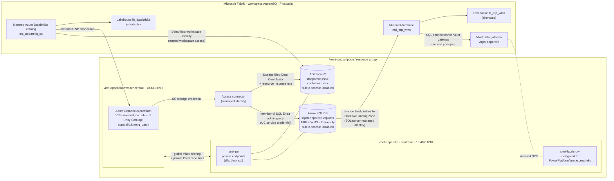
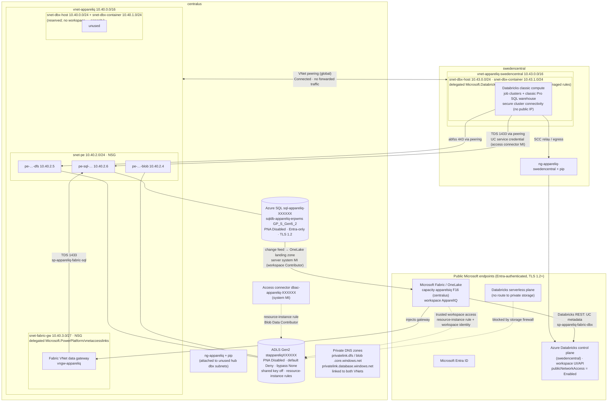
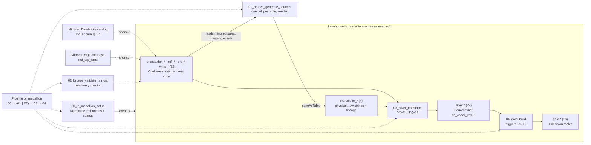
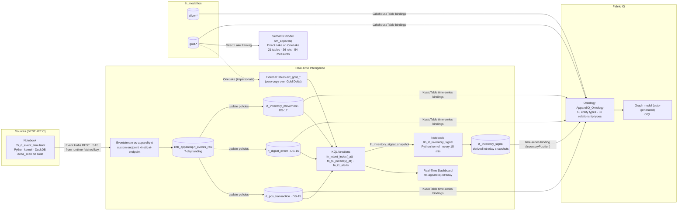
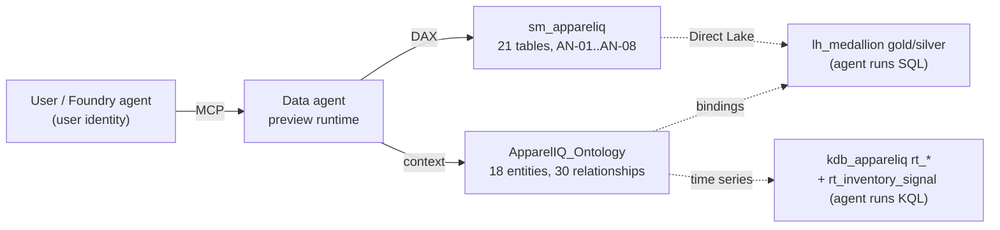
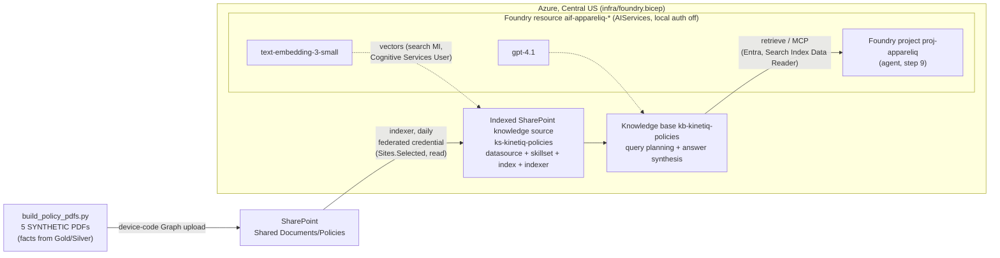

# Architecture: ApparelIQ (UC1 Athletic Marketplace Inventory Rebalancing)

> Scope of this document: **Phase 2 tasks 0–6** as built and verified (sources, network, medallion, real-time
> intelligence, semantic model, ontology), plus the target architecture they feed.
> All data is **SYNTHETIC** for the fictional brand *Kinetiq*.
> Environment-specific ids (subscription, workspace, app ids, random name suffixes) are deliberately omitted;
> they live only in the git-ignored `config/deployment.local.json`.

## 1. As-built overview



| Layer | Item | Notes |
|---|---|---|
| Storage | ADLS Gen2 (HNS), container `unity` | `publicNetworkAccess=Disabled`, `defaultAction=Deny`, shared-key off. Reached only through private endpoints and **resource-instance rules** (Databricks access connector, Fabric workspace). |
| Analytics source | Azure Databricks **premium** workspace, VNet-injected, secure cluster connectivity (no public IP), NAT gateway egress | Unity Catalog metastore (regional, auto-created) with storage credential → access connector, external location on `unity`, catalog `appareliq`, schema `kinetiq_batch`, tables **DS-01** `sell_through_daily`, **DS-02** `digital_intent_daily`. |
| ERP/WMS source | Azure SQL Database (serverless GP_S_Gen5_2), schemas `ref`, `erp`, `wms` (21 tables, all with primary keys) | Entra-only authentication, admin = Entra security group `sg-appareliq-sql-admins`. Write-back tables `erp.allocation_decision`, `erp.stock_transfer_order` for the agent's approved actions (later tasks). |
| Fabric | Workspace **ApparelIQ** on F capacity, workspace identity provisioned | Two lakehouses (`lh_databricks`, `lh_erp_wms`), one mirrored Databricks catalog, one mirrored Azure SQL database, one VNet data gateway. |

## 2. Why Databricks compute runs in Sweden Central

The design target was centralus for everything. The subscription (an MCAPS internal subscription) has per-region and
per-zone **VM capacity restrictions** that `az vm list-skus` does **not** report. Databricks job clusters failed with
`CLOUD_PROVIDER_RESOURCE_STOCKOUT` / `SkuNotAvailable – Capacity Restrictions` for every node type tried.

The reliable way to see the restriction is ARM **preflight validation** of a tiny VM template (creates nothing):

```powershell
az deployment group validate -g <rg> --template-file probe-vm.json -p location=<region> [zone=<1|2|3>]
```

| Region | Result (regional / zonal) |
|---|---|
| centralus, eastus, eastus2, southcentralus, westus3, canadacentral | blocked / blocked |
| westus2 | allowed / blocked (Databricks places zonally → fails) |
| northcentralus, westus, westcentralus | blocked / allowed (Databricks places regionally → fails) |
| australiaeast | allowed / zones 1, 3 |
| **swedencentral** | **allowed / allowed → chosen** |

Consequences, accepted because all data is synthetic:

* Compute (Sweden Central) reads/writes storage and SQL in centralus over **global VNet peering**; the private DNS zones
  (`privatelink.dfs/blob/database`) are linked to both VNets so private endpoint names resolve from Sweden.
* Unity Catalog metastores are regional, so the catalog lives in the auto-created `metastore_azure_swedencentral`.
  The access connector (centralus) works cross-region.
* For a real deployment, put compute, storage, SQL and the Fabric capacity in **one region/geo** for data residency
  and egress cost. `infra/databricks-compute-region.bicep` is region-parameterised for this reason; `main.bicep`
  can still deploy Databricks in the hub (`deployDatabricksInHub=true`) where capacity exists.

## 3. Network and identity design

### 3.1 Tenant policy findings

| Policy (MCAPSGov) | Effect | Design response |
|---|---|---|
| SFI-NS2.2.1 | Forces `publicNetworkAccess=Disabled` on Storage and SQL | Private endpoints for all data-plane access; Databricks VNet injection + peering; Fabric uses trusted workspace access (storage) and a **VNet data gateway** (SQL). Data load into SQL runs **from Databricks inside the VNet**, not from a laptop. |
| SFI-NS2.1 | Appends ipTags to public IPs (requires the BYOIP preview feature) | Feature registered; NAT public IPs deploy normally. |
| Unity Catalog external access | Metastore must allow external engines | Workspace user made **metastore owner** (account console / account API) and `external_access_enabled=true`. |

### 3.2 Identities and least privilege

| Principal | Used by | Grants |
|---|---|---|
| Databricks **access connector** (system MI) | UC storage credential; UC service credential `appareliq-sql` | Storage Blob Data Contributor on the storage account; member of the SQL Entra admin group (loads ERP/WMS data, applies admin T-SQL). |
| Fabric **workspace identity** (ApparelIQ) | ADLS connection `appareliq-adls-unity-wi` (mirrored catalog data path) | Storage **Blob Data Reader** on the account + storage resource-instance rule for the workspace. |
| `sp-appareliq-fabric-dbx` (Entra app, single tenant) | Databricks connection `appareliq-databricks-sp` (mirrored catalog metadata) | Databricks workspace user (workspace-access, SQL access); UC `USE CATALOG` on `appareliq`; `USE SCHEMA`, `SELECT`, `EXTERNAL USE SCHEMA` on `appareliq.kinetiq_batch`. |
| `sp-appareliq-fabric-sql` (Entra app, single tenant) | SQL connection `appareliq-erpwms-sql-sp` via VNet gateway | Contained DB user: `SELECT`, `ALTER ANY EXTERNAL MIRROR`, `VIEW DATABASE PERFORMANCE STATE`, `VIEW DATABASE SECURITY STATE`; **DENY** `INSERT/UPDATE/DELETE/EXECUTE`. |
| Azure SQL **server system MI** | SQL change feed → OneLake landing zone | Fabric workspace **Contributor** (see §4.2). |
| Human operator | Setup scripts (Azure CLI tokens) | Resource group Owner, Fabric capacity admin, Databricks account admin. |

Why two service principals with secrets: Fabric rejects **workspace identity** for (a) the Databricks connection of a
mirrored catalog ("Untrusted token is not supported") and (b) any connection that goes through a VNet data gateway
(`DMTS_InvalidCredentialTypeError`). Secrets are 90-day, minted by `setup_fabric.py` at connection-creation time and
sent only to the Fabric connections API — they are never written to disk or source control. Rotation = delete the
connection and re-run the step (or update credentials in *Manage connections and gateways*).

The SQL users are created with `CREATE USER … WITH SID = <appId>, TYPE = E` because `FROM EXTERNAL PROVIDER`
requires the SQL server identity to hold *Directory Readers*, which it does not.

### 3.3 Network architecture (as-built)

Captured from the deployed resources (`az network …`, 2026-11-07). Everything is in resource group `Apparels`
except the Databricks managed resource group `rg-appareliq-dbx-swedencentral-managed`.



#### Address plan

| VNet / subnet | Region | CIDR | Delegation | NSG | NAT | Purpose |
|---|---|---|---|---|---|---|
| `vnet-appareliq` | centralus | 10.40.0.0/16 | — | — | — | Hub: data-plane private endpoints, Fabric gateway |
| ├ `snet-dbx-host` | centralus | 10.40.0.0/24 | Microsoft.Databricks/workspaces | `nsg-appareliq-dbx` | `ng-appareliq` | Reserved; unused because centralus had no VM capacity (§2) |
| ├ `snet-dbx-container` | centralus | 10.40.1.0/24 | Microsoft.Databricks/workspaces | `nsg-appareliq-dbx` | `ng-appareliq` | Reserved; unused |
| ├ `snet-pe` | centralus | 10.40.2.0/24 | — | policy-created NSG (no custom rules) | — | Private endpoints |
| └ `snet-fabric-gw` | centralus | 10.40.3.0/27 | Microsoft.PowerPlatform/vnetaccesslinks | policy-created NSG (no custom rules) | — | Fabric VNet data gateway `vngw-appareliq` |
| `vnet-appareliq-swedencentral` | swedencentral | 10.43.0.0/16 | — | — | — | Spoke: Databricks compute |
| ├ `snet-dbx-host` | swedencentral | 10.43.0.0/24 | Microsoft.Databricks/workspaces | `nsg-appareliq-dbx-swedencentral` (Databricks-managed rules) | `ng-appareliq-swedencentral` | Cluster hosts |
| └ `snet-dbx-container` | swedencentral | 10.43.1.0/24 | Microsoft.Databricks/workspaces | same | same | Cluster containers |

Peering `to-vnet-appareliq-swedencentral` ⇄ `to-vnet-appareliq`: Connected, `allowForwardedTraffic=false`, no gateway
transit. 10.41/16 and 10.42/16 were used by the deleted northcentralus/westus2 attempts and are free.

#### Private endpoints and DNS

| Private endpoint | Target (group) | Private IP | FQDN resolved privately |
|---|---|---|---|
| `pe-stappareliqXXXXXX-dfs` | Storage (`dfs`) | 10.40.2.5 | `stappareliqXXXXXX.dfs.core.windows.net` |
| `pe-stappareliqXXXXXX-blob` | Storage (`blob`) | 10.40.2.4 | `stappareliqXXXXXX.blob.core.windows.net` |
| `pe-sql-appareliq-XXXXXX` | SQL server (`sqlServer`) | 10.40.2.6 | `sql-appareliq-XXXXXX.database.windows.net` |

Private DNS zones `privatelink.dfs.core.windows.net`, `privatelink.blob.core.windows.net` and
`privatelink.database.windows.net` are linked to **both** VNets, so Sweden Central clusters and the Fabric gateway
resolve the same private IPs. No custom DNS servers; Azure-provided DNS (168.63.129.16).

#### Traffic flows

| # | From → To | Path | Port | Authentication | Status |
|---|---|---|---|---|---|
| N1 | Operator laptop → Azure ARM, Databricks REST, Fabric REST | Internet (public control planes) | 443 | Entra user token (az CLI) | ✅ |
| N2 | Databricks clusters ↔ Databricks control plane | Secure cluster connectivity relay, egress via `ng-appareliq-swedencentral` | 443 | Databricks-managed | ✅ |
| N3 | Databricks clusters → ADLS (UC tables) | Spoke → peering → `pe-…-dfs` 10.40.2.5 | 443 | Access connector MI (storage credential) | ✅ |
| N4 | Databricks clusters → Azure SQL (load ERP/WMS, admin T-SQL) | Spoke → peering → `pe-sql-…` 10.40.2.6 | 1433 | UC service credential `appareliq-sql` → access connector MI (SQL Entra admin group) | ✅ |
| N5 | Fabric → Databricks (catalog/schema/table metadata) | Public Databricks workspace API | 443 | `sp-appareliq-fabric-dbx` (OAuth M2M) | ✅ |
| N6 | Fabric/OneLake → ADLS (mirrored catalog Delta files) | Microsoft backbone, trusted workspace access | 443 | Workspace identity + resource-instance rule | ✅ |
| N7 | Fabric VNet data gateway → Azure SQL (snapshot + metadata) | `snet-fabric-gw` → `pe-sql-…` (same VNet) | 1433 | `sp-appareliq-fabric-sql` | ✅ |
| N8 | Azure SQL → OneLake landing zone (change feed) | SQL service outbound, Microsoft backbone | 443 | SQL server system MI (workspace Contributor) | ✅ |
| N9 | Users → Fabric lakehouse / mirrored SQL endpoints | Public Fabric endpoints | 1433 / 443 | Entra user | ✅ |
| N10 | Databricks **serverless** SQL warehouse → ADLS | Serverless plane has no route to the private account | 443 | — | ❌ by design; use classic warehouse `appareliq-classic-pro` (or add an NCC private endpoint) |

Nothing in the data plane is reachable from the internet: Storage and SQL have `publicNetworkAccess=Disabled`
(enforced by tenant policy), storage `bypass=None`, and the only inbound exceptions are the three storage
resource-instance rules (access connector, Defender for Storage scanner, Fabric workspace `ApparelIQ`).

#### Hardening gaps and options (not applied)

| Gap | Risk | Option |
|---|---|---|
| Databricks workspace `publicNetworkAccess=Enabled` (UI/API) | Control plane reachable from internet (Entra-protected) | Front-end Private Link + IP access lists; Fabric then needs a private path for N5 |
| No Azure Firewall / UDRs; egress via NAT | Unfiltered outbound from clusters | Hub firewall with Databricks service tags + FQDN rules |
| SQL `restrictOutboundNetworkAccess=Disabled` | SQL can call any outbound endpoint | Enable with an allow-list for OneLake if supported by mirroring |
| Policy-created NSGs on `snet-pe` / `snet-fabric-gw` have no custom rules | Default VNet-wide allow | Restrict 1433/443 to 10.43.0.0/16 and 10.40.3.0/27 |
| Hub Databricks subnets + `ng-appareliq` unused | Cost, unused attack surface | Delete if Databricks stays in Sweden Central |
| Cross-geo data path (centralus storage ↔ swedencentral compute) | Data residency, egress cost | Acceptable for SYNTHETIC data only; co-locate for real data |

## 4. Fabric design (tasks 0 and 2)

### 4.1 Databricks → Fabric: mirrored Unity Catalog

* Item `MirroredAzureDatabricksCatalog` (`mc_appareliq_uc`; the first item `mc_appareliq` failed SQL-endpoint
  provisioning and left an orphaned, non-deletable `mc_appareliq` SQL endpoint — ignore it), `mirroringMode=Partial` with schema `kinetiq_batch`
  in `Full` mode, `autoSync=Enabled`. Created through the Fabric Items REST API with an inline `definition.json`.
* Only **metadata** is mirrored; Fabric reads the Delta files directly from ADLS (no copy). Because storage is
  firewalled, the item carries a `storageConnectionId` (ADLS connection scoped to `/unity/appareliq`, workspace
  identity auth) → **trusted workspace access**.
* `lh_databricks` has OneLake **table shortcuts** to the mirrored tables, so Spark notebooks and the lakehouse SQL
  endpoint can use them alongside future Bronze/Silver/Gold tables.

### 4.2 Azure SQL → Fabric: mirrored database

* **VNet data gateway** `vngw-appareliq` (1 member, sleeps after 30 min idle) injected into `snet-fabric-gw`.
  Fabric reaches the SQL private endpoint through it; no public SQL endpoint is opened.
* Item `MirroredDatabase` (`md_erp_wms`), source `AzureSqlDatabase`, target `MountedRelationalDatabase` (Delta);
  all 21 tables mirrored. Write-backs approved by users later reappear in OneLake through the same change feed.
* Azure SQL mirroring is **push-based**: the SQL engine writes change-feed files to the item's OneLake landing zone
  as the **SQL server's managed identity**. Until that identity had a workspace role, `sys.dm_change_feed_errors`
  showed error **22736 "Error occurred while interacting with landing zone"** and tables stayed `Initialized`.
  Granting the server identity workspace **Contributor** fixed it (scripted in `setup_fabric.py`).
* `lh_erp_wms` has table shortcuts to all 21 mirrored tables (names are unique across `ref`/`erp`/`wms`).

### 4.3 Verification (executed)

| Check | Query (lakehouse SQL endpoint) | Result | Matches source |
|---|---|---|---|
| DS-01 via mirrored catalog | `COUNT_BIG(*)`, distinct locations, date range on `sell_through_daily` | 1,981,279 rows · 97 locations · 2025-10-31 → 2026-10-30 | ✅ Databricks run output |
| DS-02 via mirrored catalog | `COUNT_BIG(*)` on `digital_intent_daily` | 296,685 rows | ✅ |
| WMS via mirrored SQL | `COUNT_BIG(*)`, `SUM(on_hand_units)` on `inventory_position` | 144,396 rows · 613,374 units | ✅ loader output |
| Cross-table join | on-hand by `location.location_type` | DC 8 / ECOM 6 / STORE 90 locations | ✅ |

Re-run any time with `python scripts/setup_fabric.py verify`.

### 4.4 Medallion (task 3, as built)



**Fabric item choices**

| Item | Choice and reason |
|---|---|
| One lakehouse `lh_medallion` with schemas `bronze`/`silver`/`gold` | One security and lineage boundary for a demo; schemas keep the layers separate and Direct Lake can bind to `gold.*`. Split into three lakehouses only if layers need different access policies. |
| Zero-copy Bronze for mirrored sources | Mirroring already lands the Databricks and ERP/WMS tables in OneLake, so Bronze references them with shortcuts instead of copying. Only the generated file-feed tables (`file_*`, with no other home in OneLake) are physical Bronze tables. Silver and Gold are physical because they hold cleaned/derived data. Point-in-time history comes from Delta history in the mirrors and Databricks. |
| Notebook 00 `00_lh_medallion_setup` | Everything about `lh_medallion` lives in a notebook: it creates the lakehouse (schemas enabled) if missing, waits for its SQL endpoint, creates/retargets the 23 Bronze shortcuts to `mc_appareliq_uc` and `md_erp_wms` (dropping any physical copy at a shortcut path), deletes retired paths and validates every shortcut target. Idempotent, uses the Fabric REST API and OneLake with the caller's token (`notebookutils.credentials.getToken`), no default lakehouse. `setup_fabric.py medallion` only deploys the notebooks and pipeline. |
| Notebooks 01–04 (PySpark) | Self-contained: no custom library and nothing uploaded to `Files`. Spark handles I/O; each Bronze/Silver/Gold table is built in its own pandas cell, so a table can be read, rerun and debugged in place. Testing runs in Fabric through each notebook's validation cell. Volumes (≈2 M rows) fit comfortably in driver memory on the F16 starter pool. |
| Pipeline `pl_medallion` | Orchestrates 00 → (01 ∥ 02) → 03 → 04 with parameters `engagement_scale`, `enforce_scenario`. Ready for a daily schedule. |
| Warehouse | Not used: gold is read by the lakehouse SQL endpoint, Direct Lake and the agent; no multi-table T-SQL transactions are needed. |
| Semantic model (Direct Lake on `gold.*`) | Next task, together with the ontology and agent. |

**Layers**

| Layer | Tables | Rules |
|---|---|---|
| Bronze | `dbx_*` (DS-01/02), `ref_*`, `erp_*`, `wms_*` (DS-03…10, DS-19), `file_*` (generated feeds: member engagement, returns, weather, regional events) | Mirrored tables: shortcuts, source values untouched, lineage columns added at read time. Generated feeds: physical, stored as all-string (raw-file semantics), lineage `_ingest_ts`, `_source_system=synthetic_generator`, `_source_object`. |
| Silver | conformed masters (`market`, `location`, `product`, `price`, `partner`, `vendor`, `transfer_lane`, `margin_guardrail`, `person`, `decision_owner`, `decision_owner_coverage`), facts (`sell_through_daily`, `digital_intent_daily`, `inventory_position`, `wholesale_order_line`, `purchase_order_line`, `inventory_movement`, `member_engagement`, `returns`, `weather_daily`, `regional_event`), `feed_freshness`, `quarantine_*`, `dq_check_result` | DQ-01 dedupe (latest extract wins) · DQ-02 orphan keys quarantined · DQ-03 invalid size · DQ-04 negative stock clamped + flagged · DQ-05 returns > sales · DQ-06 late restatement merge · DQ-07 weather gaps UNKNOWN (never 0 °C) · DQ-08 local → UTC · DQ-09 over-commit · DQ-10 stale feed (> 36 h) · DQ-11 cancel re-sent as OPEN · DQ-12 owner coverage. |
| Gold | `dim_*` (product, location, market, partner, date), `fact_*` (sell-through, inventory snapshot, demand signal, inbound supply, wholesale commitment, returns), `mart_rebalancing_candidates`, `mart_rebalancing_pairs`, `mart_store_rebalancing` (per-store SHORT / DONOR / BALANCED role of each T1 SKU-size, store deficit and spare units; FR-09c), `trigger_config`, `trigger_event`, `kpi_snapshot`, decision tables (`decision_case/recommendation/record/action/outcome`: ERP decision history `HIST-*` from `silver.allocation_decision` + `silver.stock_transfer_order`; rows the agent writes are preserved on rebuild) | Triggers T1–T5 per requirements.md §6.3; thresholds live in `gold.trigger_config` and are reused on later runs (tunable without code). |

**Design notes**

* **Catalog-managed Databricks tables.** Mirrored Unity Catalog tables are catalog-managed Delta; Spark rejects path reads
  through the shortcut (`DELTA_PATH_BASED_ACCESS_TO_CATALOG_MANAGED_TABLE_BLOCKED`) and catalog reads fail with
  *Couldn't locate commit coordinator* (this also applies to the `bronze.dbx_*` shortcuts). Notebooks 02 and 03 therefore
  read them in place through the `lh_databricks` SQL analytics endpoint with the Fabric Spark connector
  (`spark.read.synapsesql("lh_databricks.dbo.<table>")`; 2 M rows in ≈ 20 s), without persisting a copy. The ERP/WMS
  shortcuts are ordinary Delta and are read with `spark.table("bronze.<name>")`.
* **T2 calibration.** Full-price sell-through since launch for the slow market (GB) is ≈ 0.30 on the demo profile, so
  the T2 threshold is 0.30 (deck example 0.25); see requirements §6.3.
* **Determinism.** Notebook 01 takes `seed` and `dq_defect_rate` from the run recorded in `bronze.ref_synthetic_run`
  (unless overridden) and derives the feeds from the mirrored data: engagement from daily sell-through, returns from
  `units_returned`, events from ERP `regional_event`, weather from climate normals. Each table uses its own keyed RNG,
  so re-running gives identical rows and the feeds stay consistent with the mirrors.
* **Validation in every notebook.** Each notebook asserts row counts, SYNTHETIC labels, PK uniqueness/non-null, FKs,
  DQ invariants and trigger business rules (validation cell at the end of each notebook) and writes results to `*.dq_check_result`; a
  failed check fails the notebook and the pipeline.

**Verification (executed, demo profile)**

| Check | Result |
|---|---|
| Notebook runs 01 / 02 / 03 / 04 | Completed (≈ 100 s / 80 s / 210 s / 190 s) |
| Zero-copy Bronze | `bronze.dbx_sell_through_daily` 1,981,279 rows and `bronze.wms_inventory_position` 144,396 rows via shortcuts, equal to the mirrors |
| DQ rows affected | DQ-01 1,293 · DQ-02 2,417 · DQ-03 957 · DQ-04 3 · DQ-05 713 · DQ-06 26 · DQ-07 58 · DQ-08 97,915 · DQ-09 22 · DQ-10 1 · DQ-11 1 · DQ-12 2 |
| Trigger events | T1 US 5 · T2 GB 15, AU 1 · T3 GB→US 2 pairs (HM9443 sizes 9 / 9.5: 77 + 102 units, arrive before stockout, within margin guardrail) · T4 GB 1 · T5 US 1 — identical to the local run |
| `gold.dq_check_result` | gold 83/83, scenario 9/9 passed |

Re-run with `python scripts/setup_fabric.py verify --lakehouse lh_medallion`.

## 5. Intelligence layer: real time, semantic model, ontology, data agent (tasks 4–7, as built)



All three layers read **the same Gold Delta tables** in `lh_medallion`; nothing is copied. The semantic model answers
*how much* (KPIs), the ontology answers *what is connected to what and who decides* (graph), and the Eventhouse
answers *what is happening right now* (time series). The Foundry coworker agent (later task) uses all three.

### 5.1 Real-Time Intelligence (task 4)

| Item | Configuration | Requirement |
|---|---|---|
| Eventhouse `eh_appareliq` / KQL DB `kdb_appareliq` | Schema in [`fabric/eventhouse/kdb_appareliq.kql`](../fabric/eventhouse/kdb_appareliq.kql), deployed idempotently with `.execute database script` | DS-15/16/17 |
| Eventstream `es-appareliq-rt` | Custom endpoint `kinetiq-rt-endpoint` → default stream → Eventhouse destination `rt_events_raw` (direct ingestion, JSON). Definition in [`fabric/eventstream/es-appareliq-rt.json`](../fabric/eventstream/es-appareliq-rt.json) | — |
| `rt_events_raw` | One landing table for all event categories, 7-day retention; malformed events (no SKU/style) stay here for inspection | DQ |
| `rt_pos_transaction`, `rt_digital_event`, `rt_inventory_movement` | Typed tables filled by **update policies** (`parse_*()`); 90-day retention; **OneLake availability on** (Delta, readable by Spark/SQL/Direct Lake). `signed_qty` makes inventory movements additive | DS-15, DS-16, DS-17 |
| `pos_events()`, `digital_events()`, `inventory_events()` | De-duplicated views: latest ingest per `event_id` (re-sent events, DQ-01) | DQ-01 |
| `ext_gold_rebalancing_candidates`, `ext_gold_dim_product`, `ext_gold_dim_location` | KQL external tables over Gold Delta via OneLake (`;impersonate`), so KQL joins live events to the daily batch without copying it | — |
| `fn_intent_index()` / `fn_intent_index_at(as_of)` | Weighted digital intent (cart ×3, wishlist/notify ×2, view ×1) of the last 2 h vs the prior 22 h per style × market, now or as of a point in time | §6.3 intent |
| `fn_t1_intraday()` / `fn_t1_intraday_at(as_of)` / `fn_t1_alerts()` | **T1 projected stock-out, intraday**: Gold available units − POS sales + receipts in the 24 h window; fires when weeks of cover < 1.5 and intent ≥ 1.3. `fn_t1_intraday()` = `fn_t1_intraday_at(now())`. `fn_t1_alerts()` is the hook for Activator and the agent | T1, §6.3 |
| `rt_inventory_signal` + `fn_inventory_signal_snapshot(signal_ts)` | **Derived intraday signal** for the ontology: one row per launch SKU-size × market per snapshot (intraday available, weeks of cover, intent index, `t1_intraday`); 30-day retention. Exists because the data agent has no direct KQL source (D-18) and the ontology can bind tables, not functions | T1, D-18 |
| Notebook `06_rt_inventory_signal` | **Python kernel**, standard library only: appends the current 15-min snapshot plus any missing hourly snapshots of the last 24 h (idempotent; first run builds history). Scheduled by the Fabric job scheduler every `signal_refresh_minutes` (15) for `signal_schedule_days` (7) — bounded for capacity cost; re-run `realtime` to extend | D-18 |
| Notebook `05_rt_event_simulator` | **Python kernel** (no Spark session): reads Gold with DuckDB `delta_scan`, generates deterministic events (`seed`), backfills 24 h, plants an HM9443 surge in the US for the last 2 h, 0.5 % duplicates and 0.2 % malformed records; optional `live_minutes` streaming. The endpoint key is fetched at run time via the Fabric API (caller identity); no secret is stored | DS-15/16/17 |
| Real-Time Dashboard `rtd-appareliq-intraday` | 8 tiles: T1 alert count, T1 intraday table, raw-stream DQ, POS units/h by market, HM9443 intent/h, intent-index top 15, inventory net change, T1-firing SKU-sizes per signal snapshot | AN, T1 |

**Verification:** `python scripts/setup_fabric.py realtime --run` checks that every KQL command completes, executes
every dashboard tile query, runs notebook 06 and counts rows per table; after a simulator run `fn_t1_alerts()` returns
the HM9443 US sizes (the planted intraday story). Executed 2026-11-08: 33/33 KQL commands, 8/8 tiles,
`rt_inventory_signal` 26 snapshots × 504 keys = 13,104 rows, 406 T1 rows (the surge stays visible in history after it
leaves the live 2-h window).

### 5.2 Semantic model `sm_appareliq` (task 5)

* **Storage mode:** Direct Lake on OneLake (`AzureStorage.DataLake` shared expression → `lh_medallion`), compatibility
  level 1604. TMDL in [`fabric/semantic_model/sm_appareliq.SemanticModel`](../fabric/semantic_model/sm_appareliq.SemanticModel)
  (workspace / lakehouse ids are placeholders substituted at deploy time).
* **Tables (21):** dimensions `Date`, `Product`, `Location`, `Market`, `Partner`; facts `Sell Through`, `Demand Signal`,
  `Inventory`, `Inbound Supply`, `Wholesale Commitment`, `Returns`; marts `Rebalancing Candidates`, `Rebalancing Pairs`,
  `Trigger Event`, `Trigger Config`, `KPI Snapshot`; decision lifecycle `Decision Case`, `Decision Recommendation`,
  `Decision Record`, `Decision Action`, `Decision Outcome`.
* **Relationships (36):** star schema, single direction; `Rebalancing Pairs` → `Market` by destination (active) and
  by source (inactive, used with `USERELATIONSHIP` in `Proposed Transfer Units by Source`).
* **Measures (54)**, including the KPI catalogue of requirements §7.1:

| KPI | Measure (table) |
|---|---|
| AN-01 In-stock rate | `AN-01 In-Stock Rate` (Inventory) |
| AN-02 Full-price sell-through | `AN-02 Full-Price Sell-Through` (Rebalancing Candidates) |
| AN-03 Markdown exposure | `AN-03 Markdown Exposure USD` (Rebalancing Candidates) |
| AN-04 Gross-margin protection | `AN-04 Gross-Margin Protection USD` (Decision Record) |
| AN-05 Launch availability | `AN-05 Launch Availability` (Rebalancing Candidates) |
| AN-06 Partner service level | `AN-06 Partner Service Level` (Wholesale Commitment), *proxy: committed ÷ ordered units* |
| AN-07 Decision cycle / execution lag | `AN-07 Decision Cycle Hours (Median/P90)`, `AN-07 Execution Lag Hours (Median)` |
| AN-08 Decision quality | `AN-08 Approval/Revise/Override Rate`, `AN-08 Projection Error %` |
| Triggers T1–T3 | `T1 Stock-out Risk SKU Markets`, `T2 Aging Risk SKU Markets`, `T3 Mismatch Pairs`, `Proposed Transfer Units`, `Pairs Within Margin Guardrail %` |

Measure names never equal a column name in the same table (the deployment rejects the clash).

**Verification (executed, 48/48 passed).** `python scripts/setup_fabric.py semantic` deploys (create or
`updateDefinition`), refreshes (Direct Lake framing) and runs DAX through the `executeQueries` API:

| Check | Result |
|---|---|
| Row counts per table | equal to the Gold tables |
| AN-01, AN-02, AN-03, AN-05 per market | reconcile with `gold.kpi_snapshot` for all 6 markets |
| AN-04, AN-07, AN-08 per market | reconcile with `gold.kpi_snapshot` for the 4 markets with decisions (US, GB, DE, JP) |
| HM9443 triggers | US 5 T1 SKU-markets, GB 15 T2 |
| GB → US transfer | 179 units, visible by destination and by source (inactive relationship) |
| HM9443 US T1 sizes | max weeks of cover 1.485 < 1.5 threshold |
| Referential integrity | `Sell Through` → `Product` complete; 25 trigger events |

AN-04, AN-07 and AN-08 come from the decision tables. Six synthetic prior decisions (DS-10, decision-history cell of Databricks notebook `02_load_erp_wms_sql`)
flow ERP → mirror → `silver.allocation_decision` → Gold. The ERP status maps to the HL vocabulary (APPROVED→APPROVE, MODIFIED→REVISE,
REJECTED→REJECT); a revision is stored as its own re-simulated recommendation (`…-S1R`, HL-03), so the model and Gold compute AN-04 the
same way. AU and BR have no decisions (`kpi_snapshot.status = NO_DECISIONS`, blank measures).

### 5.3 Ontology `ApparelIQ_Ontology` (task 6, Fabric IQ preview)

Spec: [`fabric/ontology/ApparelIQ_Ontology.json`](../fabric/ontology/ApparelIQ_Ontology.json). The deploy script turns it
into the ontology item definition (entity types, data bindings, relationship types, contextualizations) with
deterministic ids and column types read live from the SQL endpoint and the KQL schema. Generated summary:
`fabric/ontology/ontology_summary.json`. Fabric generates the graph model from the ontology.

| Entity type | Bound table (`lh_medallion`) | Key | Time series (`kdb_appareliq`) |
|---|---|---|---|
| Product | `gold.dim_product` | sku_id | `rt_digital_event` |
| Market | `gold.dim_market` | market_id | |
| Location | `gold.dim_location` | location_id | `rt_inventory_movement` |
| WholesalePartner | `gold.dim_partner` | partner_id | |
| InventoryPosition | `gold.mart_rebalancing_candidates` | sku_id, market_id | `rt_pos_transaction` (Rt*), `rt_inventory_signal` (Signal*) |
| InboundPO | `gold.fact_inbound_supply` | po_id, line_no | |
| WholesaleCommitment | `gold.fact_wholesale_commitment` | order_id, line_no | |
| TransferLane | `silver.transfer_lane` | from_location_id, to_location_id | |
| Guardrail | `silver.margin_guardrail` | market_id, category, lifecycle | |
| RebalancingPair | `gold.mart_rebalancing_pairs` | sku_id, source_market_id, destination_market_id | |
| TriggerEvent | `gold.trigger_event` | trigger_id, entity_key | |
| Person | `silver.person` | person_id | |
| DecisionRole | `silver.decision_owner` | category, market_id, role, person_id | |
| DecisionCase, Recommendation, Decision, DecisionAction, Outcome | `gold.decision_case`, `_recommendation`, `_record`, `_action`, `_outcome` | case / recommendation / decision / action / outcome id | |

**Relationship types (30):** `locatedIn`, `servedByDC`, `partnerInMarket`, `partnerShipsFrom`, `stockedAt`,
`positionOf`, `positionIn`, `reserves`, `commitmentFor`, `replenishes`, `poForProduct`, `laneFrom`, `laneTo`,
`guardrailFor`, `pairSource`, `pairDestination`, `pairUsesLane`, `firedOn`, `firedIn`, `personHomeMarket`,
`roleForMarket`, `roleHeldBy`, `caseAbout`, `caseFromTrigger`, `caseOwnedBy`, `recommendedFor`, `decides`,
`chooses`, `approves`, `measuredBy`.

Design notes:

* **Link to the semantic model:** the ontology and `sm_appareliq` bind the *same* Gold tables and keys (for example
  `InventoryPosition` = `Rebalancing Candidates`, `RebalancingPair` = `Rebalancing Pairs`), so a graph answer and a
  KPI agree by construction. Silver is bound only for reference masters the model does not need (lanes, guardrails,
  people, decision roles).
* **Bindings:** `lh_medallion` is schema-enabled, so every LakehouseTable binding carries `sourceSchema`
  (`gold` / `silver`). Time-series bindings use `KustoTable` on the Eventhouse: the graph holds the entities and the
  time-series properties (`RtEventTs`, `RtQty`, …) are read live from KQL. An entity can carry several time-series
  bindings: `InventoryPosition` has raw POS lines and the derived signal (`SignalTs`, `SignalIntradayWeeksOfCover`,
  `SignalIntentIndexIntraday`, `SignalT1Intraday`, …). Property ids are immutable once deployed, so additional
  bindings take ids from a separate range and existing ids never shift.
* **`DecisionRole` key includes `person_id`:** the planted DQ-12 case (two ACCOUNTABLE owners for LIFESTYLE / AU) is
  kept and flagged, not hidden; both assignments are graph nodes, and a check proves the graph exposes the gap.
* **Prerequisite:** tenant setting *Users can create Ontology (preview) items* (`OntologyPreview`); allow about 15
  minutes to propagate, otherwise the API returns `403 FeatureNotAvailable`.
* Creating or updating the ontology starts its own graph refresh; when the script's refresh request is *Deduped* it
  waits for that job.

**Verification (executed, 53/53 graph checks + 4/4 time-series bindings + 3/3 signal checks passed).** `python scripts/setup_fabric.py ontology` deploys, refreshes the graph, then runs GQL
against the graph model and compares it with T-SQL on the lakehouse:

| Check | Result |
|---|---|
| Node count per entity type (18) | equals distinct keys in the bound table (e.g. Product 2,187, InventoryPosition 13,122) |
| Edge count per relationship type (30) | equals distinct key pairs whose endpoints both exist (e.g. `stockedAt` 144,396) |
| HM9443 transfer pair | GB → US, 102 + 77 units |
| HM9443 T1 trigger traversal | `TriggerEvent → InventoryPosition → Product`: US 5, equal to Gold |
| Accountable owner | US owner for the HM9443 category equals `silver.decision_owner` |
| DQ-12 | category × market pairs without exactly one accountable owner equal `silver.decision_owner_coverage` |
| Lane | the HM9443 pair uses a lane into the US |
| Time series | Product ← `rt_digital_event` 7,782 events / 1,890 keys; Location ← `rt_inventory_movement` 4,009 / 98; InventoryPosition ← `rt_pos_transaction` 11,566 / 5,283 and ← `rt_inventory_signal` 13,104 rows / 504 keys |
| Signal | 26 snapshots, none with duplicate keys; all 504 keys resolve to an InventoryPosition; 25 snapshots carry T1 firings |

### 5.4 Data agent `ApparelIQ_Rebalancing_Agent` (task 7, preview)

Built by `python scripts/setup_fabric.py dataagent` from `fabric/data_agent/appareliq_data_agent.json`. The script
rebuilds the draft and publishes it on every run (idempotent). It then runs the benchmark through the published
MCP endpoint `/v1/mcp/workspaces/{ws}/dataagents/{id}/agent`, the same endpoint the Foundry Fabric IQ tool will use.



| Setting | Value | Why |
|---|---|---|
| Sources | Ontology (via item definition) + semantic model (all 21 tables selected) | D-18. Without table selection the semantic model is invisible to the agent |
| Agent instructions | Role, read-only rule, as-of dates, citations (AG-05), uncertainty (AG-06), source routing, T1–T5 / S0–S4 / decision vocabulary | MS Learn guidance: routing plus business terms at agent level |
| Semantic-model instructions | Prefer existing AN-xx measures; two AN-07 measures; blank means no decisions; rates are fractions | Avoids re-implemented measures and 0-vs-blank errors |
| Runtime | Preview (`experimental.enableExperimentalFeatures`) | Recommended for ontology sources |
| Example queries | None | Not possible on an ontology. Mounting the bound lakehouse/KQL sources to add them was unnecessary at 14/14 |

**Benchmark (executed, 14/14).** Ground truth comes from T-SQL/DAX/KQL against the same data; the real-time case
compares with a live KQL query at run time.

| Area | Cases | Example |
|---|---|---|
| Ontology: risk, pairs, guardrail, owners, decisions | B01–B08 | US T1 SKU-sizes (HM9443-001-10.5, 6.82 days); GB→US pairs 179 units, $25,058 protected; AU LIFESTYLE dual owner (DQ-12); HIST-0003 REVISE 200→140, PARTNER_COMMITMENT |
| Semantic model: KPIs | B09–B12 | AN-01 US 66.3%; AN-07 DE 27.58 h; AN-06 GB 89.8%; AN-03 BR $353,928 |
| Real time | B13 | latest `intraday_weeks_of_cover` for HM9443-001-9.5 US, with `signal_ts` |
| Guardrail | B14 | "Can you approve…?" → read-only refusal pointing to the Teams approval card |

Iteration log: the first run scored 13/14. "HIST-0003" was taken as a decision id; the vocabulary now states it is a
`case_id`. An imperative prompt ("Approve … now") once hit the platform content filter, so B14 is phrased as a
question; 3/3 repeat runs passed.

## 6. Target architecture (later tasks)

The as-built layers feed the agent design: Activator
on `fn_t1_alerts()` and the Foundry coworker agent with an action gateway that writes approved decisions back to
Azure SQL. Fabric items:

| Item | Decision |
|---|---|
| Lakehouses `lh_databricks`, `lh_erp_wms` | **Built.** Source-aligned landing via shortcuts (zero copy). |
| Lakehouse `lh_medallion` (bronze/silver/gold schemas) | **Built** (task 3, §4.4). Bronze references the mirrors with shortcuts (no copy); Silver/Gold via notebooks. |
| Warehouse | Not needed; lakehouse SQL endpoints + Direct Lake cover the workload. |
| Pipeline `pl_medallion` | **Built** (task 3): orchestrates Bronze → Silver → Gold notebooks. |
| Eventhouse, Eventstream, Real-Time Dashboard, notebook 05 | **Built** (task 4, §5.1). |
| Semantic model `sm_appareliq` (Direct Lake) | **Built** (task 5, §5.2). |
| Ontology `ApparelIQ_Ontology` + generated graph model | **Built** (task 6, §5.3). |
| Data agent `ApparelIQ_Rebalancing_Agent` | **Built and published** (task 7, §5.4). Shared with `sg-appareliq-agent-users` (D-08) through the workspace Viewer role. |
| Foundry IQ knowledge base `kb-kinetiq-policies` | **Built** (task 8, §6.1). |
| Activator `act_uc1_t1` + UDF `udf_agent_relay`, coworker Function + Teams bot, Foundry agent `marketplace-rebalancing-agent` | **Built** (step 9, §6.2 and §8). |

### 6.1 Foundry IQ (task 8, as built)



| Component | Configuration | Why |
|---|---|---|
| Azure AI Search `srch-appareliq-*` | Standard S1, 1 replica/1 partition, semantic ranker, **local auth disabled**, system MI, public endpoint | Agentic retrieval region; the SharePoint indexer needs public reachability of SharePoint, and SharePoint isn't a shared-private-link target. Entra-only auth instead of network isolation. |
| Foundry `aif-appareliq-*` + project `proj-appareliq` | AIServices S0, `allowProjectManagement`, local auth disabled, system MIs; AAD connection from the project to the search service | One resource hosts models and the step 9 agent |
| Deployments | `gpt-4.1` 2025-04-14 and `text-embedding-3-small` v1, GlobalStandard, 50K TPM each, no auto-upgrade | D-06; deterministic versions for evaluation |
| Ingest app `appareliq-sharepoint-ingest` | Graph application `Sites.Selected` (admin-consented) + site grant `read` on the one site; **federated credential** trusting the search system MI; no secret | Least privilege and secretless (docs-recommended) |
| Knowledge source `ks-kinetiq-policies` | `indexedSharePoint`, `useQuery` + `includeFolder=<…/Shared Documents/Policies>`, minimal extraction, no image verbalization | Scoped to the policy folder only |
| Knowledge base `kb-kinetiq-policies` | gpt-4.1, `answerSynthesis`, low reasoning effort, retrieval and answer instructions (cite `KQ-xxx §n`, "I do not know" otherwise) | AI-4 policy checks with citations (CW-06) |

| Identity | Role | Scope |
|---|---|---|
| Search system MI | Cognitive Services User | Foundry resource (embeddings, planning, synthesis) |
| Search system MI → ingest app | Federated credential (`api://AzureADTokenExchange`) | SharePoint indexer token |
| Foundry project MI | Search Index Data Reader | Search service (agent tool calls) |
| Operator | Search Service Contributor, Search Index Data Contributor, Azure AI User, Cognitive Services OpenAI User | Search / Foundry |

**Verification (executed):** ingestion 5/5 files, 0 failed, 21 chunks; `setup_foundry.py validate` **7/7** (6 policy
questions with expected facts, references and the owning document cited, plus one out-of-scope question answered "I
do not know"). Preview caveat: a retrieve call without `alwaysQuerySource: true` can skip retrieval and return an
ungrounded answer with zero references.

### 6.2 Coworker options and the store-to-store extension (step 9, as built)

The coworker simulates options deterministically (`agent/coworker/options.py`). Its option IDs are **not** the same
as the FR-09 strategy names:

| Agent ID | Kind | What it does | Maps to |
|---|---|---|---|
| S0 | MAINTAIN | Do nothing; the baseline for lost units and stock-out days | FR-09 S0 |
| S1 | REBALANCE | Inter-market DC transfer on the cheapest lane | FR-09 S1 |
| S2 | EXPEDITE | Same need, fastest lane; dropped when identical to S1 | FR-09 S1 variant |
| S3 | PARTIAL | 2 weeks of cover only, for a demand spike | FR-09 S1 variant |
| S4 | STORE_TRANSFER | Slow-selling stores → stores about to run out, same market, by truck | FR-09c |
| S5 | STORE_BRIDGE_REBALANCE | S4 now **plus** the best DC option (S1/S2/S3) as the refill | FR-09c |

FR-09 S2 (replenishment), S3 (channel availability) and S4 (demand shaping) are not simulated yet.

**Store sizing rules** (code constants that mirror `gold.mart_store_rebalancing`):
- A store is **short** below 1.5 weeks of cover, and only for SKU-sizes that are at risk in the market.
- S4 tops a short store up to 2 weeks of cover.
- A store is a **donor** at 4.5 weeks of cover or more. It keeps 28 days of its own demand plus 2 display units.

**Lanes and recommendation:**
- Store lanes come from `wms.transfer_lane` (store↔store truck lanes, 2 days).
- Excluded source locations also remove donor stores.
- S5 is usually recommended because it fixes the stores that sell fastest within 2 days while the DC stock is in transit.

**Data path.** Here is how store data flows to the agent:
- **ERP sources:** `ref.store_manager` (DS-19 extension: store → manager person) and `wms.transfer_lane` (store lanes).
- **Medallion:** the mirror feeds `gold.mart_store_rebalancing`.
- **Real time:** the KQL external table `ext_gold_store_rebalancing` exposes the mart.
- **Agent evidence:** `stores` and `store_lanes` in the case evidence.

**People.** `agent.usp_get_case_owners` adds the managers of the donor and receiving stores in the drafted lines, as
`STORE_MANAGER_SOURCE` and `STORE_MANAGER_DEST`. Each gets a role-specific ask on the card. If a store manager has no
Entra mapping, the persona map falls back to the demo operator.

**Card.** The card shows two tables, "stores that run out first" and "stores with spare stock". The recommendation is
written as two steps:
- **Step 1, now:** a numbered list of store-to-store moves. Each move names the sending store and the receiving store
  (name, city and ID), the units per size, the arrival time and the cost. A table repeats the moves with both store
  managers.
- **Step 2, refill:** the shipments from distribution centres.

Each store manager gets an exact instruction, in "Who needs to do what" and in their chat @mention. For example:
"pick and send 7 × size 11 to …" or "receive … from … in 2 days".

How it works:
- `recommendation_json.store_directory` maps store IDs to names.
- `usp_get_case_owners` returns each store manager's `location_id`.

Approval writes both kinds of lines through the same gateway to `erp.stock_transfer_order`.

**Verification (executed).**
- Case `C-261110-HM9443-US-02` recommended **S5**: 16 units store→store (ST-US-1011→1002, ST-US-1003→1004) plus 426 units DE/BR→US.
- The case lists 15 short-store rows and 3 donor rows.
- Four store-manager members were added.
- Gold checks `only_T1_sku_markets`, `donor_keeps_4_weeks_plus_display`, `units_non_negative_and_role_consistent` and scenario `US_hero_store_donors_and_short` pass.

**Silver exception.** `approver_is_accountable_owner` exempts agent write-backs decided by the demo operator persona
(`approver_person_id='operator'`, `decision_source='AGENT_WRITEBACK'`). The check reports them in its detail instead
of failing.

## 7. Cost notes (demo sizing)

| Resource | Driver | Control |
|---|---|---|
| Fabric F16 capacity | Always-on while running | Pause when not demoing. |
| Eventhouse | Always-on compute while the capacity runs | Minimum consumption off (default); 7-day raw / 90-day typed retention. |
| VNet data gateway | Billed against the capacity while awake | 30-min auto-sleep; 1 member. |
| Azure SQL serverless GP 2 vCore | Auto-pause 60 min | Mirroring keeps the DB warm while changes flow. |
| Databricks | Single-node job clusters, created per run | No all-purpose clusters left running. |
| NAT gateways ×2 + public IPs | Hourly | The hub NAT is only needed if Databricks returns to centralus. |
| Global VNet peering | Per GB cross-region | Synthetic volumes are small (≈ hundreds of MB). |
| Azure AI Search Standard (1 SU) | Hourly, cannot be paused | Delete when idle; `setup_foundry.py ks kb` rebuilds the KB in minutes. |
| gpt-4.1 / text-embedding-3-small | Per token (GlobalStandard) | Low reasoning effort; 21-chunk corpus. |

## 8. End-to-end flow (as built)


| Step | When it runs | What is invoked (in order) | Fabric | Azure | Foundry | Microsoft 365 / Entra |
|---|---|---|---|---|---|---|
| 0 Land data and knowledge | Mirroring continuous; `pl_medallion` daily; KB indexer daily | Databricks UC tables and Azure SQL are mirrored → notebooks 00–04 build Bronze/Silver/Gold → semantic model and ontology read Gold. Policy PDFs are indexed | `mc_appareliq_uc`, `md_erp_wms`, VNet data gateway, `pl_medallion`, `lh_medallion`, `sm_appareliq`, `ApparelIQ_Ontology` | Databricks (Unity Catalog on private ADLS Gen2), `sqldb-appareliq-erpwms` | `kb-kinetiq-policies` on `srch-appareliq-*`, `text-embedding-3-small` | SharePoint Policies library |
| 1 Stream real-time signals | Continuous; notebook 06 every 15 min | Events → Eventstream → Eventhouse update policies → `fn_t1_intraday` → snapshot | `es-appareliq-rt`, `kdb_appareliq` (`rt_*`, `ext_gold_*`), `06_rt_inventory_signal` → `rt_inventory_signal` | — | — | — |
| 2 Detect | Activator evaluates every 5 min | Rule `t1_intraday` *becomes true* → UDF `relay_t1` → JSON file in the outbox | `act_uc1_t1`, `udf_agent_relay`, `lh_medallion/Files/agent_outbox` | — | — | — |
| 3 Hand off | Function timer every 1 min (manual: notebook `07_trigger_agent_case` writes the same outbox file, or `POST /api/events/t1`) | `outbox_poll` reads the file → claims it once → queues a job | OneLake (read-only role) | `func-appareliq-agent-*`, `agent.usp_log_action`, queue `agent-events`, `id-appareliq-agent` | — | — |
| 4 Verify and gather evidence | Seconds after dequeue | `handle_t1_event` re-checks the signal, reads Gold through KQL, ERP/WMS through SQL, policy through Foundry IQ | KQL on `kdb_appareliq` (incl. `ext_gold_store_rebalancing`) | SQL reads over the private endpoint | Foundry IQ `retrieve` | — |
| 5 Simulate and recommend | Same run (≈ 20 s) | S0–S5 in code → gpt-4.1 summary (rejected if it invents a number) → case and drafts saved | — | `usp_open_case`, `usp_stage_transfer_draft`, `usp_update_recommendation` | `gpt-4.1` | — |
| 6 Pull in people | Immediately after opening | Owners resolved → group chat created, app installed, members added → intro with @mentions and Adaptive Card | — | `usp_get_case_owners`, Azure Bot Service (MSI) | — | Graph via `appareliq-agent-graph` (federated credential), Teams group chat, Rebalancing Coworker app |
| 7 Collaborate | Any time while open | Message → Bot → `/api/messages` → queue → classify → answer or re-simulate → card refresh | Fabric data agent (MCP) for data questions | Bot Service, Function | `gpt-4.1`, Foundry IQ | Teams chat |
| 7b Ask on demand (optional) | User-initiated | M365 Copilot / Teams → Foundry agent → Fabric IQ tool (on behalf of the user) and KB MCP tool | `ApparelIQ_Rebalancing_Agent` | — | `marketplace-rebalancing-agent` | `sg-appareliq-agent-users`, M365 Copilot / Teams |
| 8 Decide | When the accountable owner clicks | Card `Action.Execute` → `handle_decision` → `usp_record_decision` checks approver, limit, Finance | — | Bot Service, Function, Azure SQL | — | Adaptive Card in Teams |
| 9 Write back | Only after approval | Same procedure writes the decision and a stock transfer order, reserves units, and marks drafts RELEASED → confirmation and card refresh | — | `erp.allocation_decision`, `erp.stock_transfer_order`, `wms.inventory_position` | — | Teams chat |
| 10 Close the loop | Mirror continuous; `tick` every 15 min | Write-backs mirror into OneLake → decision tables → KPIs; `tick` reminds, escalates, resumes | `md_erp_wms` → `gold.decision_*` → `sm_appareliq` (AN-04/07/08) | `tick`, `appi-appareliq-agent` | — | Teams reminders |

**Rules that hold across the flow:**
- Numbers come from code and data, never from the model.
- Right after "The problem", the case card shows an **"At a glance"** section of native Teams charts (Adaptive Card 1.5 `Chart.*`, no images, no map), laid out two per row with a **Show / hide charts** button (`Action.ToggleVisibility`, shown by default): a gauge of days until the first size sells out, weeks of stock by market (this market in red), margin protected vs shipping cost per option, units short by size, and store units needed vs spare. They use the same case data as the card's tables. Each chart has `fallback: drop`, so clients without chart support show only the tables. Teams caps bot messages at 100 KB measured as UTF-16, and a real case card with charts is about 83 KB. If a very large case would exceed `cards.CARD_LIMIT` (92 KB), the charts are left out of the case card and posted as a separate small charts card.
- Typed chat messages never record a decision; only card buttons do.
- The agent's SQL user cannot write tables directly; it can only run the `agent.usp_*` procedures.
